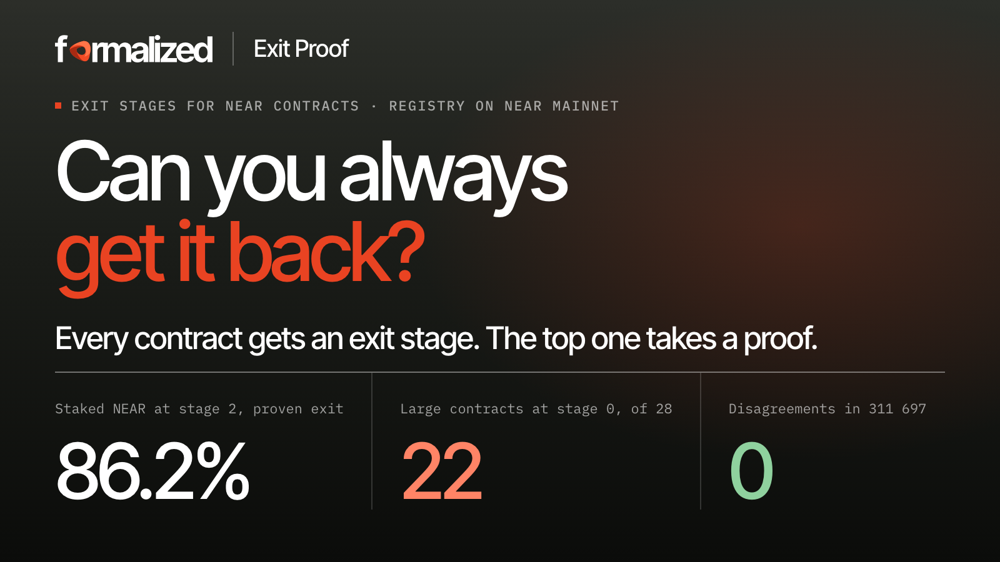
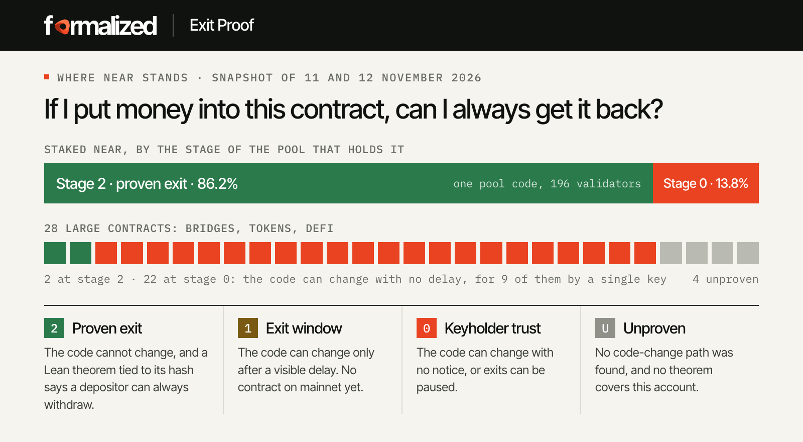
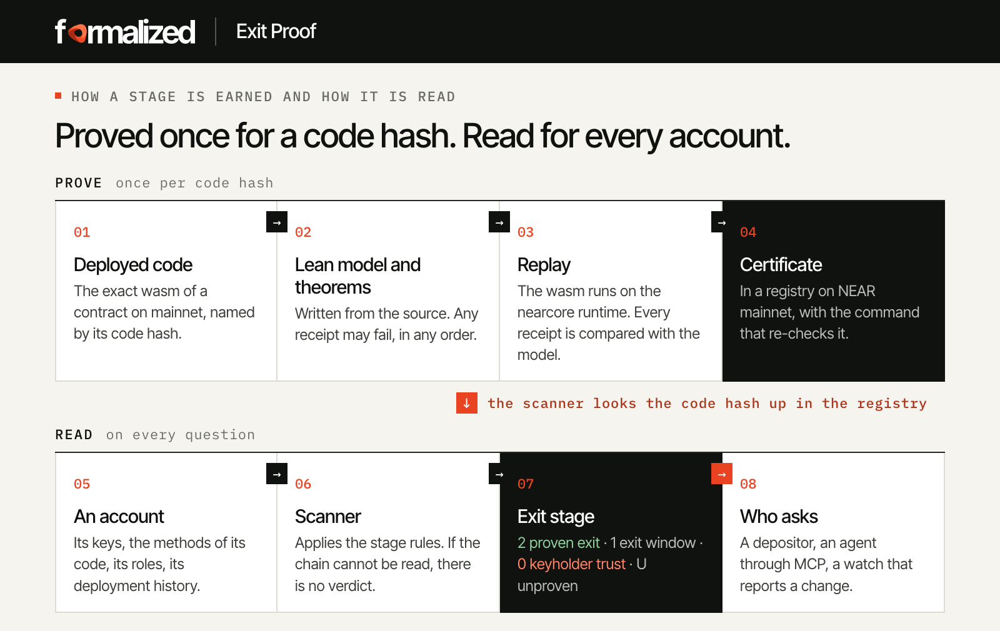

<div align="center">

# Exit Proof

### Before you deposit: can you always get the money back?

**Every NEAR contract gets an exit stage. The top stage takes a Lean theorem tied to the deployed code hash.**

[](https://github.com/formalized-si/exit-proof/actions/workflows/ci.yml)
[](https://nearblocks.io/address/registry.exitproof.near)
[](intents-proof/lean/Intents/Theorems.lean)
[](LICENSE)

[Try it](#try-it) · [Stages](#exit-stages) · [Where NEAR stands](#where-near-stands-today) · [What is proved](#what-is-proved) · [Intents Proof](#intents-proof-for-standard-tokens-the-ledger-of-near-intents-never-credits-more-than-it-holds) · [How it works](#how-it-works) · [Why NEAR](#why-near) · [FAQ](#faq) · [Documentation](#documentation)

**[Open the page](https://formalized-si.github.io/exit-proof/)**: the scanner runs in your browser ·
**[Watch the video](docs/assets/exit-proof-promo.mp4)** (1 min 43 s)

<code>./check-all.sh</code>

<br />



</div>

---

"If I put money into the smart contract, I can withdraw it back, right? … which by the way requires that the smart
contract is not upgradable" — Illia Polosukhin, 2026-11-06 ([video](https://www.youtube.com/watch?v=xpou72TAJ-s)).
Nobody can check this before depositing. Explorers call a contract "locked" when its account has no full-access
keys, and `token.sweat`, USDT and `intents.near` have none, yet each can replace its own code through a contract
method.

Exit Proof answers the question for any NEAR account. It reads who can change the code and who can move or
freeze the funds, and gives the contract an **exit stage**. Each stage is defined by evidence that anyone can
check again. The top stage takes a machine-checked theorem: Lean proofs of exit for the staking pool code that
holds 86.2% of staked NEAR and for wNEAR, tied to the deployed bytes and recorded in a registry on NEAR mainnet.
The same method, applied to the contract that holds users' tokens for NEAR Intents, gives the largest part of
this repository: a proof that its token ledger never credits more than it holds, for standard tokens.

Built for NEAR HACKATHON 2026 by [Mike Murunov](https://x.com/mike_genproof) and
[Maksim Borisov](https://x.com/mbor1sov) of [formalized.si](https://formalized.si/).

**Exit Proof found none of the incidents it mentions.** The teams of those contracts found them, fixed them and
published what happened. A theorem here is about a Lean model; the tie to the deployed bytes is a hash and a
replay of the exact wasm, and it is measured, not proved.

## Try it

[The page](https://formalized-si.github.io/exit-proof/) answers for any account without an install: it runs the
scanner of this repository in your browser, and a link such as
[`…/exit-proof/#check=wrap.near`](https://formalized-si.github.io/exit-proof/#check=wrap.near) opens with the answer. On the command line: Python 3.10 or newer and nothing else. Every
command reads public RPC and signs nothing.

| Do | See |
|---|---|
| `python3 tools/exitproof.py astro-stakers.poolv1.near` | `EXIT STAGE 2 — PROVEN EXIT`, then the certificate on mainnet, the theorem, what it assumes and the command that re-checks it |
| `python3 tools/exitproof.py token.sweat` | `EXIT STAGE 0 — KEYHOLDER TRUST: upgrade plugin with no exit window`, then the upgrade methods and how strongly each is guarded |
| `python3 tools/agent_demo.py astro-stakers.poolv1.near 100`, then the same for `liver.pool.near` | `decision: PROCEED` with the transaction an agent would sign, then `decision: REFUSE` with the reasons |
| `python3 tools/token_check.py batman-4.nearlytrade.near` | `TOKEN CHECK: DEVIATES FROM NEP-141`, the monitors that fired on runs of its code, and `transfer tax ON` read from the token now |
| `python3 tools/exitproof.py gated-quiet-vault.testnet --network testnet` | `EXIT STAGE 1 — EXIT WINDOW (168 h, certified upgrades only)`: a contract whose upgrades need a certificate |
| `python3 -m http.server 8000` in the repository, then open `http://localhost:8000/web/` | The page, served from your checkout: type an account and press **Read the exit stage** |
| `./check-all.sh` (one to three minutes) | The numbers of this page against the evidence files, then the self-test on real accounts; the run ends with `RESULT: PASS` |

[More to try](#more-to-try) has the exit plan of a delegator, the watch, the MCP server for agents, the live
ledger of NEAR Intents and the kit for token teams.

## Exit stages

| Stage | Meaning | Evidence |
|---|---|---|
| **2 — Proven exit** | the code cannot change and a depositor can always withdraw by its own calls | no code-change path and no access key of any kind `[chain]`,`[code]` + a Lean exit theorem registered on chain for the exact code hash by an accepted attestor `[proof]` + the account's state was made by this code: one code deployment, or every deployment recorded by the proof (`wrap.near`: two, under a stated condition) `[hist]` |
| **1 — Exit window** | the code can change only after a visible delay, long enough to leave | this code runs the proved upgrade plugin — an `upgrade-window` certificate for its code hash, or a proof of this repository for it `[proof]` — no other code-change method is found by name `[name]`, the plugin's window is non-zero `[view]`, and every view it depends on answered; names alone give stage 0 |
| **0 — Keyholder trust** | the code can change with no notice, or exits can be paused / deposits moved | the scanner names the path and how it is guarded: DAO vote, multisig, another contract, several keys, one key |
| **U — Unproven** | no code-change path found, and no exit theorem that covers this account | absence of evidence, stated as such: no theorem for the code hash, or the account has a key or a history the theorem does not cover |

Full rules: [`docs/STAGES.md`](docs/STAGES.md). Reports show the strength of each guard, never a list of key holders.
A stage 2 rests on a certificate of an attestor the reader accepts; the one attestor today is `exitproof.near`,
the project's own account with one key, and each certificate names the command that re-checks it.
The ladder follows the idea of L2BEAT's Stages for rollups and DeFiScan's stages for DeFi protocols; what is added
here is the top rung: a stage is 2 only with a machine-checked exit theorem tied to the deployed code hash.

## Where NEAR stands today



- **Staking.** By stake, **86.2% of NEAR is at stage 2**, 13.8% at stage 0, none at stage 1 — of the NEAR staked
  with the 340 validators of one epoch, not of all NEAR. The 86.2% is one keyless
  pool code run by 196 validators (500.9M NEAR); the rest is pool code with an `upgrade` method that takes effect with
  no delay, plus one pool with a full-access key (snapshot 2026-11-11, `docs/CENSUS.md`, raw data in `evidence/`).
- **Live state.** At one pinned block (224 223 218, 2026-11-12) all 196 of 196 pools running the proved code
  satisfy the theorem's precondition: each pool's balance covers its staked total plus every delegator's unstaked
  balance, its share books are consistent, and it has no access keys — 256 564 delegator accounts, 501.6M NEAR
  staked (`evidence/pools-live.json`, re-run with `tools/pools_live.py`). Each of the 196 has had exactly one code
  deployment, made by the factory `poolv1.near` in the receipt that created the account: its state was made by
  the proved code alone (`evidence/pools-origin.json`, read from an indexer on 2026-11-13).
- **Large contracts.** Of 28 bridges, tokens and DeFi contracts scanned, 22 are at stage 0: their code can change with
  no delay, for 9 of them by a single key. 2 are at stage 2, 4 are unproven, none is at stage 1 (`docs/CENSUS.md`).
- **Upgrade delays.** 4 of 4 contracts read that use the standard upgrade plugin have no staging delay.
- **Tokens.** Of the 395 fungible tokens that the NEAR Intents ledger held at block 224 273 043, 371 have a verdict
  from runs of their deployed code against the proved token properties (86 code hashes in the census, 71 of them run, read 2026-11-12): 355 behave as the NEP-141
  standard, 14 deviate (a transfer tax; for one build the settlement reports a refund that is not made), 2 are
  under review. 201 of the 355 run code with an extension that changes transfers when it is switched on (a fee, a
  tax, a burn on bridging out). Of the 217 tokens listed on the largest exchange, 163 were run: 153 standard, 8
  deviate, 2 under review (`evidence/token-census.json`, `tools/token_check.py`). The runner of this census and
  its per-family configurations are not in the repository: the verdicts are a saved result, and
  `token-monitors/` is the part that re-runs one token's code.

## On mainnet

`registry.exitproof.near` keeps the certificates. It has no access key and no upgrade method, and it holds
nobody's funds.

| Step | Transaction |
|---|---|
| Deploy the registry (near-sdk 5.30.1) | [`Bb34SR1z…`](https://nearblocks.io/txns/Bb34SR1zsenLKVcjLrkacnvguYqtmGrghgN1e3Fub8t5) |
| Certificate, kind `exit`: the core staking pool, code `J1arLz48…` | [`31oaqvX2…`](https://nearblocks.io/txns/31oaqvX2N8WEvihboMQ7WoV4jt563F314fGoeERMdkFK) |
| Certificate, kind `exit`: wNEAR, code `DL2f5xmZ…` | [`7h4KGyi9…`](https://nearblocks.io/txns/7h4KGyi9Quu2Fo5yvwtWuj8jA341mvv77spPcMZqBmec) |
| Certificate, kind `token-standard`: the reference token of near-contract-standards 5.29.0 | [`7cnk2Urb…`](https://nearblocks.io/txns/7cnk2Urb64ELBVouhACmznGw4rLqgyNjjXwRc4NHZaVf) |
| Certificate, kind `upgrade-window`: the reference vault of the upgrade plugin | [`BpAq7sGT…`](https://nearblocks.io/txns/BpAq7sGTnFFfJoRQn3RcUya3qkXGny6EydeVbTTrZg7K) |
| Delete the registry's only access key | [`F6ypQV24…`](https://nearblocks.io/txns/F6ypQV24ZzofmRncQhZMkTaRb5HY2mfgdUSdq8CowCam) |

Each certificate pins a hash of the proof directory and names the command that re-checks the proof.
[EVIDENCE.md](EVIDENCE.md) lists every transaction of the registry and of the stage-1 examples on testnet;
[gated-upgrade/TESTNET.md](gated-upgrade/TESTNET.md) has the vault that refused uncertified code.

## What is proved

Lean 4.35, no `sorry`. A statement is about a model that is tied to the deployed bytes by hash and by execution.

| Subject | Proved in Lean (about a model) | Tested on the deployed bytes | Read from the chain | Not covered |
|---|---|---|---|---|
| Core staking pool, the code of `*.poolv1.near` | a delegator can always unstake and withdraw; nobody else lowers its balance | model and wasm agree on 1149 random traces; a wrong model is noticed: 8 of 8 one-line changes ([`pool-mutants/`](pool-mutants/README.md)) | 196 pools satisfy the precondition at one block | storage staking; that the protocol returns the stake is an assumption |
| wNEAR (`wrap.near`) | a holder can always unwrap, under an invariant of the state | 2000 traces | the solvency part of the invariant at one block | the rest of the invariant on mainnet; the code the account ran before 2021 |
| Token standard, `near-contract-standards` 5.29.0 | supply is the sum of balances; settlement refunds at most what was sent; only the token settles | a reference token, 10 of 10 one-line mutants | — | other library versions (verdicts for them come from runs, `evidence/token-census.json`) |
| Token ledger of NEAR Intents (`intents.near`) | the ledger never exceeds the holdings for a standard token and for wNEAR; withdrawals settle exactly; who can lower a balance, with the checks made | every receipt of 4 000 traces replayed through the model, 0 disagree; 114 of 121 one-line changes of the model noticed | the live ledger against the holdings, per token; the 19 code hashes the account has had | multi-token and NFT paths; the `token_diff` swap path and fees (moves that balance by assumption, not generated by the replay); gas; the signature standards; a proof about the bytes |
| Upgrade plugin, `near-plugins` v0.5.1 | no deploy is accepted before a bound that is tight | 6000 traces, 12 of 12 mutants | the plugin users read on mainnet have no delay set | contracts that changed the plugin |
| Gated upgrades (`gated-upgrade/`) | every code change installs code that had a certificate | 2 000 traces, 10 scenarios | a testnet example | the gate is as strong as the attestors it accepts |
| Any contract: its exit stage | — | — | keys, exported methods, roles, registry, deployment history | below stage 2 the verdict rests partly on method names and on the contract's own views |

Three levels of evidence are kept apart everywhere: **proved** is a theorem about a Lean model, **tested** is the
model run against the exact deployed wasm, **read** is chain state or a contract's own answer. `CLAIMS.md` has every
claim with its level; `docs/ROADMAP.md` lists what is missing.

Two of the statements, as Lean reads them. For the ledger of NEAR Intents: in every reachable state the sum of
the ledger balances is at most the token balance of the contract, with anything in flight, at any point of any
interleaving.

```lean
theorem T1_ledger_covered (K : Cfg) (S : World) (h : Reach K S) :
    total S.L.bals ≤ bal S.c.accts K.me
```

For a staking pool: from any reachable state a delegator's `unstake_all` leaves it at least its claim, and four
epochs later, once the protocol has returned the stake, `withdraw_all` sends at least that amount, whatever the
other accounts did in between.

```lean
theorem exit_guarantee {vk : String → Bool} {self : AccountId} {w0 : World}
    (hR : Reach vk self w0) (u : AccountId) … :
    ∃ w1, … ∧ claim w0.c u ≤ (w1.c.get u).unstaked ∧
      ∀ w2, Others vk self u w1 w2 → w0.epoch + NUM_EPOCHS_TO_UNLOCK ≤ w2.epoch → PUA w2 → … →
        ∃ c3 eff, exec vk w2.c (w2.env self u 0) .withdrawAll = .ok (c3, eff) ∧ claim w0.c u ≤ eff.transfer
```

The whole statements are in [`intents-proof/lean/Intents/Theorems.lean`](intents-proof/lean/Intents/Theorems.lean)
and [`pool-proof/lean/StakingPool/Exit.lean`](pool-proof/lean/StakingPool/Exit.lean).

Each subject with its exact statement, its assumptions and the numbers of its runs: [`CLAIMS.md`](CLAIMS.md) and the
README of its directory. An independent adversarial review of the first two proofs, with non-vacuity examples and
a second kernel: [`docs/REVIEW.md`](docs/REVIEW.md).

## Intents Proof: for standard tokens, the ledger of NEAR Intents never credits more than it holds

The largest part of this repository is [`intents-proof/`](intents-proof/README.md): a machine-checked proof about the
token ledger of `intents.near`. About $3.8M was lost on this contract in 2026 when a ledger credit was not backed
(`docs/BACKGROUND.md`); that loss was on the multi-token deposit path, which has no theorem here yet — the proof
covers the fungible-token paths.

- **Proved** (136 statements — theorems and the lemmas listed with them — Lean 4.35): in every reachable state the ledger total is at most the tokens the contract
  holds — for a standard token and for wNEAR, in any order of receipts, with any receipt failing; withdrawals settle
  exactly, with the documented exceptions named; a credit happens only when tokens have arrived.
- **Who can take from an account** (`T4_authorised`): one step lowers a ledger balance in six ways only — the
  account's own call; its signed payload, with a key registered for it and an unused nonce, by at most the amount
  its intents name, once; the refund of a transfer call made to it, by at most that transfer, once; or a forced
  operation by a holder of two named roles. A key of an account is made only by the account, a holder of a role only
  by a super-admin or an admin of that role — and the statement names the power that remains: a super-admin can give
  itself any role with one call.
- **Tied to the deployed code**: the commit the contract names in its own metadata rebuilds to the deployed bytes,
  byte for byte; 311 697 receipts of the deployed wasm replayed through the model: 308 469 agree, 0 disagree, the
  outcome of 3 228 is not compared (failures forced by the harness, receipts out of gas, signature checks); token
  and contract replayed together through the step function the theorems are about (209 557 receipts agree, 0
  disagree). The replay is measured, not assumed: of 121 one-line changes of the model, at least one for every
  guard, it notices 114; the other 7 no receipt can show, and the Lean build fails with each of them (for three of
  the seven only at a lemma that restates the changed definition). 23 106 calls of guarded methods by accounts
  without the permission, none ran. An independent reviewer's own 23 changes are
  among the 121 — the replay first noticed 10 of them, which is how its blind spot in the permission rules was found
  and closed (`intents-proof/MUTANTS-REVIEW.md`). What the replay does not reach: the generator makes no
  `token_diff` intent and no `auth_call`, so the balancing of a swap between signers and its fees, which the model
  takes as moves that balance (`intents-proof/lean/NOTES.md` §4, item 7), are neither proved nor replayed.
- **Checked three more ways**: a second kernel (62 496 declarations), a TLA+ specification model-checked over
  79 million states, and a blind re-statement of the theorems that found and fixed two wrong sentences.
- **Survives upgrades**: `intents-proof/scripts/verify_upgrade.sh` took the newest commit of the contract, not yet
  deployed, and answered in two minutes: it behaves the same on the run, no new place writes the ledger, and three
  files the model mirrors changed — these, and only these, have to be re-read before the certificate is reused.
- **The assumption, read token by token**: the proof needs tokens that behave as the standard; `tools/token_check.py`
  gives a verdict from runs of the code for 371 of the 395 fungible tokens the ledger held (a saved census whose
  runner is not in this repository). For a token that keeps part of a transfer the statement is false, in the model
  (`T5`) and on the live contract: `tools/intents_backing.py` reads the ledger against the holdings for every token
  at one block (`evidence/intents-live-backing.json`: 396 tokens at block 224 299 938).
- **One code among eighteen**: the account has had 18 codes (19 code hashes, counting the account before it had
  code); its code changed 18 times between 2024-11-05
  and 2026-10-07 (`intents-proof/evidence/intents-code-history.json`, read from archival state). The theorems are
  about the latest, `BtA1BEFN…`, and about the states it reaches from an empty ledger; the live ledger was also
  written by the earlier ones.

`cd intents-proof && ./check.sh --mutants --tla` re-checks all of it (38 minutes on a fresh copy with nothing built, on a
busy shared machine; about 26 minutes once the harness is built).

## Verified upgrades: an upgrade without a certificate cannot land

A proof about an upgradable contract lasts until the next upgrade. [`gated-upgrade/`](gated-upgrade/README.md) closes
that gap from the contract's side: a vault whose code is replaced only by code that was staged a fixed time in
advance **and** has a valid certificate in the registry from an accepted attestor. The standard upgrade plugin is
unchanged; one method, `deploy_certified()`, asks the registry and only then lets the plugin deploy.

- **Proved** (`gated_code_change`): every code change installs code whose hash had an accepted certificate when the
  registry was asked, was staged before, and happens no earlier than the proved bound `safeUntil`.
- **Tested** on the nearcore runtime: 10 scenarios with 82 checks, 2 000 random traces (281 198 receipts) with no
  violation; 5 904 direct deploy calls and 8 633 callbacks refused.
- **Live on testnet**: `vault.gated-upgrade.testnet` deployed certified code after its window (and refused the same
  call a few seconds early), then refused to deploy staged code that has no certificate
  (`gated-upgrade/TESTNET.md`; `./check.sh --testnet` reads it back from the chain).
- The scanner reads the gate and does not flatter it: `python3 tools/exitproof.py vault.gated-upgrade.testnet
  --network testnet` prints `EXIT STAGE 0 … certified upgrades only, but code is staged (6AFnkHg3NKz9…) and its delay has passed: it
  is deployed as soon as one of 1 accepted attestor(s) certifies its hash — no time bound`. That example was left with
  uncertified code staged. A gated vault with nothing staged is at stage 1: `python3 tools/exitproof.py
  gated-quiet-vault.testnet --network testnet` prints `EXIT STAGE 1 — EXIT WINDOW (168 h, certified upgrades only)`.
- **Limits**: a certificate is a statement by an attestor, not a proof checked on chain, so the gate is as strong
  as the attestors it accepts (the example accepts one); the example's gate accepts the existing certificate kind
  `upgrade-window`, and a kind that says "this code keeps the proved properties of the code it replaces" does not
  exist yet; a stager can restart the delay, so nothing is guaranteed about an upgrade ever landing; a certificate
  revoked after the registry answered does not stop that deployment.

## How it works



- **Scanner.** For an account it reads the access keys, the exported methods of the wasm, the contract's own role
  and delay views, the deployment history and the registry. It applies the rules of [docs/STAGES.md](docs/STAGES.md).
  A report shows how strongly each power is guarded, never who holds it. When the chain cannot be read there is no
  verdict.
- **Proofs.** Each proof directory has a Lean model written from the contract's source, the theorems, and a
  harness that runs the exact deployed wasm on nearcore's own runtime and compares it with the model. One-line
  changes of the model measure whether the comparison would notice a difference.
- **Registry.** A contract on mainnet with no access key. It stores certificates by code hash. It does not check
  a proof on chain: it records who attests what, pins the proof directory by hash and names the re-check command.
- **Stage 2** takes all of these: no code-change path, a certificate for the exact code hash from an attestor the
  reader accepts, no access key, and a deployment history that shows the account's state was made by this code: one
  deployment, or every deployment recorded by the proof.
- **Tools on top**: the token check, the watch, the exit plan of a delegator, a reference agent, an MCP server,
  the upgrade check for a contract team and the certification kit for a token team.

Trusted, not proved:

- **The tie between a model and the deployed bytes.** It is hash equality plus execution on random traces. For
  the Intents ledger the replay notices 114 of 121 one-line changes of the model, and no receipt can show the
  other 7. That is strong evidence. It is not a proof about wasm.
- **The attestor.** The one attestor so far, and the owner that admits attestors, is an account with one key. A
  certificate is that account's statement plus a command anyone can re-run.
- **Method names and the contract's own views.** Below stage 2 the verdict rests partly on them, and a contract
  can misreport.
- **The indexer.** The deployment history that stage 2 needs is an indexer's list (NearBlocks, API v3 with v1 as a
  fallback). It shows the first and the latest deployment: one row means one deployment. For `wrap.near`, whose
  proof covers two, the full list was read once from every deployment receipt (`evidence/wrap-near-deployments.json`,
  `tools/deploy_history.py`); a later deployment would change the latest row.
- **The Lean kernel, the nearcore runtime in the simulator, and NEAR.**
- **The token census.** Its runner is not in this repository; the verdicts are a saved result.

**A stage is about exits. It is not about every risk**: an oracle, the economic design and a bridge are outside it.

## Why NEAR

- The guarantees are about NEAR mechanics: access keys versus contract-level upgrade methods, global contracts
  referenced by account id, the staking pool's epoch-based unstake/withdraw cycle, the asynchronous
  `ft_transfer_call → ft_on_transfer → ft_resolve_transfer` receipt flow, the upgrade plugin's staging delay.
- Conformance runs the exact mainnet bytes on nearcore's own runtime.
- Certificates live on NEAR mainnet in `registry.exitproof.near`, a contract with no access keys and no upgrade
  method: the scanner finds no way to change its code and reports it as stage U, since nothing is proved about it.
  Its code cannot change; who may attest can: the owner that admits attestors, `exitproof.near`, is an ordinary
  account with one key, and so is the one attestor so far. A certificate is that account's statement plus a
  command anyone can re-run.

## Run it

| Command | Needs | Time | Action |
|---|---|---|---|
| `./check-all.sh` | Python 3.10+ | 1 to 3 min | The numbers in the documents against the evidence files, then the self-test (51 checks) on real accounts |
| `./check-all.sh --offline` | Python 3.10+ | seconds | The same without the network |
| `./check-all.sh --proofs` | Linux x86-64, `elan`, `rustup`, a C/C++ compiler, `cmake`, libclang, `java` | 70 min with nothing built | Adds the `check.sh` of the six proof directories and of the token kit: each model against the deployed wasm, the mutants of `intents-proof/` and of the token kit, the TLA+ runs. The mutants of the other directories: `--all` of `wnear-proof/` and `token-standard/`, `--mutants` of `upgrade-window/` and `gated-upgrade/`, and `pool-mutants/run.sh` |
| `cd intents-proof && ./check.sh --mutants --tla` | the same | 38 min with nothing built, about 26 once the harness is built | The Intents proof alone |
| `lake build` in the `lean/` of a proof directory | Lean 4.35.0 through `elan` | minutes | The proofs alone; `Axioms.lean` (for the pool `lean/scripts/Axioms.lean`) prints the axioms of the theorems |

The long times are those of one run on a fresh copy, on a busy shared machine. [AGENTS.md](AGENTS.md) maps each
statement of this page to a command and to the line that supports it. Without root, libclang comes from
`python3 -m pip install libclang` plus `LIBCLANG_PATH` (details in `upgrade-window/README.md`, "Needs").

## More to try

Steps 1–11 need only Python 3.10+ (standard library; step 11 with `--git` also needs git). They read public RPC
and the NearBlocks deployment history; nothing is signed.

1. `python3 tools/exitproof.py astro-stakers.poolv1.near` — under the header line: `EXIT STAGE 2 — PROVEN EXIT`; below
   it the on-chain certificate, the theorem, its assumptions and the re-check command.
2. `python3 tools/exitproof.py token.sweat` — `EXIT STAGE 0 — KEYHOLDER TRUST: upgrade plugin with no exit window`,
   then the upgrade methods and how they are guarded: by a DAO whose own code its factory can replace without a vote.
3. `python3 tools/agent_demo.py astro-stakers.poolv1.near 100` — `decision: PROCEED` with the evidence and the
   transaction the agent would sign. `python3 tools/agent_demo.py liver.pool.near 100` — `decision: REFUSE`, stage 0,
   with the reasons.
4. `python3 tools/exit_plan.py figment.poolv1.near --example` — for the first delegator the pool lists: the two calls
   that take everything out, the earliest time of the second, and the theorem behind each step. For your own stake:
   `python3 tools/exit_plan.py <pool> <your account>`.
5. `python3 upgrade-window/check-upgrade-window.py token.sweat` — `exit window now  none`.
6. `python3 tools/exitproof.py staged-vault.exitproof-demo.testnet --network testnet` —
   `EXIT STAGE 1 — EXIT WINDOW … NEW CODE IS STAGED`, with the time left to withdraw. (From 2026-11-19 17:47 UTC the
   staged code is deployable and the same command reports stage 0; `quiet-vault.exitproof-demo.testnet` stays at
   stage 1.)
7. Token check: `python3 tools/token_check.py batman-4.nearlytrade.near` — `TOKEN CHECK: DEVIATES FROM NEP-141`, the
   monitors that fired on runs of its code, `transfer tax ON` read from the token now, and whether its code can
   change. `python3 tools/token_check.py usdt.tether-token.near` — `CORE BEHAVES AS NEP-141, HAS EXTENSIONS`, and
   for a contract that accepts it `unknown`: its owner can pause transfers, blacklist an account and destroy its
   funds. A code hash outside the census is reported as `NOT CHECKED`, never as a pass. The field
   `behaves_as_standard_now` has three values: `true`, `false` (the runs deviate, or a fee or tax view of the token
   reads on: `nearsight.v2-launchpad.justhoot.near`) and `null` — unknown, when a privileged party can freeze or
   lower a holder's balance (`holder_balance_powers`), when the code has an extension that changes transfers and no
   view that holds a field recognised as its fee (`eth.omft.near`), or when the token's code follows another account.
8. Watch: `python3 tools/watch.py intents.near astro-stakers.poolv1.near --state watch-state.json` records the code
   hash, stage, keys, upgrade delay, staged code and certificates of each account; the next run prints one line per
   change (`CODE CHANGED`, `STAGE`, `UPGRADE STAGED`, `KEYS`, `TAX`) and exits with 1. Run it from a scheduler.
9. Agents: `python3 tools/mcp_server.py` is an MCP stdio server with three tools, `exit_check(account_id)`,
   `exit_plan(pool_id, account_id)` and `token_check(token_id)`. Client config:
   `{"mcpServers": {"exit-proof": {"command": "python3", "args": ["tools/mcp_server.py"]}}}`
   Every answer has `structuredContent` with a `status` (`ok`, `not_found`, `unreadable`, `bad_argument`, `error`) and an
   output schema; `unreadable` means nothing is known and is never a pass. `exit_check` and `token_check` take an
   optional `network`. `exit_check` with `detail: "stage"` (command line: `--fast`) answers with the stage and its
   reasons from 4 to 20 reads, in two or three seconds; the full answer also reads who holds each power, up to 100
   reads, and takes ten seconds or, when the public endpoints rate-limit the caller's address, a minute or more —
   set `EXITPROOF_RPC` to your own endpoint. The server keeps an answer for a minute.
10. The live ledger of NEAR Intents: `python3 tools/intents_backing.py --table` prints, for the 396 fungible tokens
   the ledger lists, how many have the ledger equal to, below or above what the contract holds, by the verdict of
   the token's code (the saved reading of one block; without `--table` it reads the chain again, about 40 minutes).
   For the 354 tokens with a standard verdict the ledger never exceeds the holdings.
11. Registry: `python3 tools/registry_get.py J1arLz48fgXcGyCPVckFwLnewNH6j1uw79thsvwqGYTY` prints the certificate
   stored on NEAR mainnet for the pool code (the same as `near view registry.exitproof.near get_valid …`). The
   `artifact_sha256` in it is the hash of the proof directory in this repository; re-compute it with
   `python3 tools/bundle_hash.py pool-proof --git`.
12. Proofs: with Lean 4.35 (elan), `lake build` in `pool-proof/lean`, `wnear-proof/lean`, `token-standard/lean`,
   `upgrade-window/lean`; each directory's `Axioms.lean` (for the pool `pool-proof/lean/scripts/Axioms.lean`) prints the
   axioms of the theorems.
13. Full re-check, model against wasm on the nearcore runtime: `pool-proof/check.sh`, `wnear-proof/check.sh`,
   `token-standard/check.sh`, `upgrade-window/check.sh`. Each exits with 0 only if everything holds. They need Linux
   x86-64, `elan`, `rustup`, a C/C++ compiler, `cmake` and libclang, and build near-contract-sim first: about
   10 minutes each on a machine with nothing installed, 2–5 minutes afterwards. Without root, libclang comes from
   `python3 -m pip install libclang` plus `LIBCLANG_PATH` (details in `upgrade-window/README.md`, "Needs"). The
   checks rewrite their run logs inside the proof directories; `tools/bundle_hash.py <dir> --git` still gives the
   attested hash, and `git checkout -- <dir> && git clean -fdq <dir>` restores the directory.
14. Token teams: `token-monitors/certify.sh your.wasm your-config.json` runs your own token wasm — any library version,
   any initialiser — through 1 000 random traces on the nearcore runtime with 14 model-free monitors of the proved
   NEP-141 properties and writes a certificate; `python3 tools/token_check.py <token> --certificate certificate.json`
   checks that the file is consistent and is for the code the token account runs, and shows it as a claim that
   changes no verdict: a file proves nothing about who wrote it. Re-run it with
   `token-monitors/verify-certificate.sh certificate.json your.wasm --rerun`; after that `--accept-certificate` makes
   the tool count it. Four tokens taken from mainnet were
   certified this way (`evidence/token-certificates/`); the monitors catch 7 of 10 one-line mutants of the reference
   token, the other 3 change only NEAR accounting or gas, which the monitors do not read. For a token built on
   near-contract-standards 5.29.0, `token-standard/certify-token.sh` compares with the exact Lean model instead.

## FAQ

**Did Exit Proof find the bugs of 2026?** No. The SWEAT and NEAR Intents teams found them, fixed them and
published what happened. This repository uses the deployed code of those contracts as the object of proofs and
tests.

**Is stage 2 a proof about the bytes on chain?** No. It is a theorem about a Lean model, plus the evidence that
the model and the deployed wasm behave the same on random traces, plus the checks of the scanner. The certificate
on chain is an attestor's statement with a command that re-checks it. Nothing checks a proof on chain: a Lean
kernel run for theorems of this size does not fit in NEAR's gas limit.

**Who decides that a contract is at stage 2?** The rules of [docs/STAGES.md](docs/STAGES.md), applied by a
script anyone can run. The part that needs trust is the attestor, and the scanner counts only the attestors on
its list. Today that list has one account.

**Why does `wrap.near` say "under a stated condition"?** Its theorem holds in states that satisfy an invariant.
On mainnet the solvency part of the invariant is checked at one block; "supply equals the sum of balances" over
2.68 million records is not. The account also ran another code before 22 April 2021, and what that code left is
tested, not proved. The report prints this first.

**Does the Intents proof cover the path of the 2026 loss?** No. That loss was on the multi-token deposit path,
and the proof covers the fungible-token paths. The headline also holds only for a token that behaves as the
standard: for a token that keeps part of a transfer the statement is false, in the model and on the live
contract, and the repository shows both.

**What does an agent get?** An MCP server with three tools: `exit_check`, `exit_plan` and `token_check`. Every
answer carries a status, and `unreadable` means that nothing is known. It is never a pass.

**Is it on mainnet?** The registry is, with four certificates. The tools read mainnet. The examples of stage 1
and of the gated vault are on testnet: none of the four mainnet users of the upgrade plugin we read has a staging
delay set, and a delay gives stage 1 only for code whose plugin is certified.

**What does it cost?** Reading is free. An attestation costs the storage of its record, 0.02 to 0.03 NEAR.

## What is next

- **The page as an explorer.** Today it answers for one typed account. Next: a list of the largest contracts
  with their stages, kept current by the watch.
- **The multi-token paths of NEAR Intents**, where the 2026 loss happened, the `token_diff` swap path with its fees
  in the replay and in the model, and the strict statements about who can lower a balance for wNEAR.
- **Code-change paths from the wasm, not from names**: below stage 2 the scanner reads method names; a call graph
  from the exported methods to the deploy and add-key host functions would replace that.
- **Token certificates in the registry**, so that an agent finds one without a file.
- **The next largest holders of deposits**: liquid staking contracts and the pool code with an `upgrade` method.
- **A second attestor**, and re-checks that anyone can run and record on chain.

[docs/ROADMAP.md](docs/ROADMAP.md) has the thirteen known gaps.

## Repository layout

| Path | Contents |
|---|---|
| `tools/` | scanner and stage (`exitproof.py`), token check (`token_check.py`), watch (`watch.py`), exit plan, MCP server, reference agent, censuses, the full deployment list of an account (`deploy_history.py`), bundle hash, numbers check (`numbers_check.py`), regression check (`selftest.py`) |
| `intents-proof/` | the token ledger of NEAR Intents: Lean model and theorems, harness on the deployed wasm, TLA+ specification, upgrade gate, `check.sh` |
| `gated-upgrade/` | a vault that upgrades only to certified code: contract, Lean theorem, tests, the testnet example |
| `pool-proof/`, `wnear-proof/` | Lean models and exit theorems, conformance harnesses, evidence, `check.sh` |
| `pool-mutants/` | one-line changes of the pool model replayed against the pool's traces: does the comparison notice a wrong model |
| `token-standard/` | readable properties and proofs for near-contract-standards 5.29.0, `certify-token.sh`, mutants |
| `token-monitors/` | a kit for a token team: model-free monitors of the same properties for any token wasm, config format, certificate, self-check |
| `upgrade-window/` | model and proofs of the upgrade plugin's delay, mainnet checker, mutants |
| `registry/` | registry contract (near-sdk 5.30.1), certificates as files, deploy and attest scripts |
| `docs/` | [`STAGES.md`](docs/STAGES.md) (the stage rules), [`DEMO.md`](docs/DEMO.md) (two demo scripts, about 90 seconds each), [`BACKGROUND.md`](docs/BACKGROUND.md) (incidents and sources), [`CENSUS.md`](docs/CENSUS.md) (validators and large contracts by stage), [`DESIGN.md`](docs/DESIGN.md) (design decisions), [`REVIEW.md`](docs/REVIEW.md) (independent review of the first two proofs), [`REPRO.md`](docs/REPRO.md) (the rebuild attempt of the 2020 pool code), [`DEVELOPMENT.md`](docs/DEVELOPMENT.md) (how the parts fit, how to change them), [`ROADMAP.md`](docs/ROADMAP.md) (status, gaps, next steps) |
| `web/` | the page: it loads Python for the browser and runs `tools/exitproof.py` and `tools/token_check.py` unchanged; the numbers it shows come from the evidence files |
| `docs/assets/` | the pictures of this page and the pages they are rendered from (`src/`, with `src/build.sh`; the fonts are those of `web/fonts/`), and the video (`exit-proof-promo.mp4`) |
| `evidence/` | the censuses (validators, large contracts, tokens), the live readings of the pools and of the Intents ledger, the deployment history the stage-2 origin rests on, the token certificates |
| `CLAIMS.md`, `EVIDENCE.md` | exact claims with evidence levels; on-chain transactions |
| `check-all.sh`, `AGENTS.md` | one command for every check; each check with its time and the line a passing run ends with |
| `CONTRIBUTING.md`, `SECURITY.md`, `CHANGELOG.md`, `THIRD_PARTY_NOTICES.md` | the rules for a change, how to report a problem, the work by day, the code of other authors |

## Documentation

- [AGENTS.md](AGENTS.md): every check, how long it takes, and the line that supports each statement of this page.
- [CLAIMS.md](CLAIMS.md): each claim with its level of evidence: proved, tested, read or heuristic.
- [Stage rules](docs/STAGES.md), [census](docs/CENSUS.md), [design decisions](docs/DESIGN.md),
  [background and sources](docs/BACKGROUND.md).
- [The Intents proof](intents-proof/README.md): the theorems, the assumptions, the live ledger, what is not
  covered. [Verified upgrades](gated-upgrade/README.md). [The kit for token teams](token-monitors/README.md).
- [Roadmap](docs/ROADMAP.md), [development guide](docs/DEVELOPMENT.md), [demo script](docs/DEMO.md),
  [on-chain evidence](EVIDENCE.md), [changelog](CHANGELOG.md).

Report a way to get a better answer from a tool than its rules allow through [SECURITY.md](SECURITY.md).

## What is not ours, and how this was written

- **The contracts under proof** are other teams' code, used as published: `near/core-contracts` (the staking pool
  at `1cacc9d`, wNEAR at `54f8267`), `near-contract-standards` 5.29.0 and 3.1.0, `near-plugins` v0.5.1 and
  `near/intents` at `16d04f6e`. The mutation tests apply one-line changes to copies of the plugin and of the token
  standard.
- **Libraries and tools of other authors:** `near/near-contract-sim` at `8e4b69b` with nearcore 2.14.0 (the runtime
  the conformance runs use), near-sdk 5.30.1 (the registry contract), Lean 4.35.0 without Mathlib, cargo-near 0.22,
  the TLA+ tools, Pyodide (the page), and the fonts Inter Tight and IBM Plex Mono.
  [THIRD_PARTY_NOTICES.md](THIRD_PARTY_NOTICES.md) has the licenses, and the `NOTICE` file of each proof directory
  has the committed third-party files with their hashes.
- **Built with AI coding agents.** Mike Murunov and Maksim Borisov built Exit Proof with Claude Code, and the agents wrote most of the
  code: the Lean models and proofs, the harnesses, the tools, the page and the documents. The independent reviews
  that the documents name were made by separate agents that took no part in the work and read the repository cold.
  No outside party audited any of it.

- **Our own earlier work:** none of the code. The page reuses the stylesheets and the mark of [formalized.si](https://formalized.si/)
  (`web/styles.css`, `web/page.css`, `web/assets/`), shared with the other project pages of the team.

## Built at NEAR HACKATHON 2026

We wrote Exit Proof for NEAR HACKATHON 2026, from 11 to 14 November, inside the window that opened on 2026-10-19.
The repository is published as one commit of 14 November, in that window, tagged `hackathon-submission`;
[CHANGELOG.md](CHANGELOG.md) lists the work by day. What the reviews found, and what changed, is in the documents:
[docs/REVIEW.md](docs/REVIEW.md), `intents-proof/MUTANTS-REVIEW.md`, [SECURITY.md](SECURITY.md).

**A second project of ours.** Our organization built a second project for this hackathon:
[Emet](https://github.com/formalized-si/emet) ("No Proof, No Upgrade (Emet)" in the project list). It answers a
different question: who decides which patch a contract installs? Emet runs a Lean proof checker inside a NEAR contract,
and a gate upgrades a contract only after that checker accepts a proof on chain. The two projects share no code (their
pages use the same formalized.si stylesheets). Both use Lean 4.35.0 and both study NEAR Intents: Exit Proof takes the
token ledger, and Emet takes one refund expression. Each has an upgrade gate of its own.

Where it fits: **security** — an agent checks a contract before it deposits (`exit_check` over MCP), a contract
checks a token before it credits what the token reports, and a vault upgrades only to certified code; **open** —
machine-checked theorems tied to the code that runs on NEAR mainnet, for the staking pool, wNEAR and the token ledger
of NEAR Intents.

## Contributing

Issues and pull requests are welcome. [CONTRIBUTING.md](CONTRIBUTING.md) has the setup, the checks to run before
a change, and the few rules that keep those checks meaningful.

## License

The license is [MIT](LICENSE). Components that are not ours keep their own licenses, and
[THIRD_PARTY_NOTICES.md](THIRD_PARTY_NOTICES.md) lists them.
